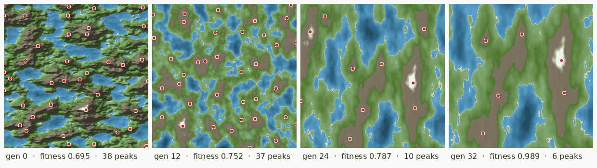
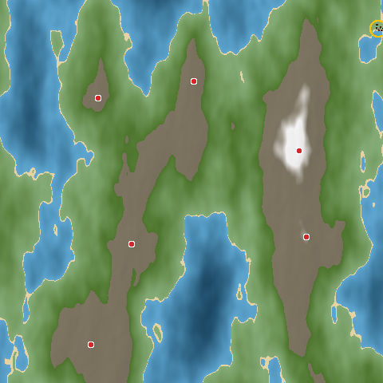
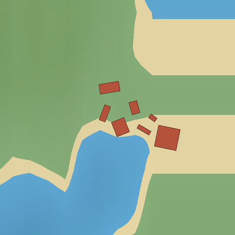
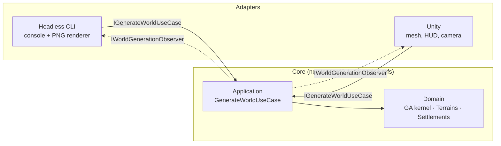

# Genetic Map Generator

Evolves 3D terrain to a user's specification with a genetic algorithm, then evolves a settlement on it.
You ask for a biome mix (water / grassland / mountain) and a number of peaks; the GA searches the
parameters of a fractal-noise terrain generator until the map matches. A second GA then lays out a
village on flat, dry land to hit targets for buildings, floor area, inhabitants and prosperity.

Originally my BSc dissertation project (Unity, 2017–18), rebuilt as an engine-agnostic core that runs
headless or renders in Unity.



| Final world (peaks in red, settlement circled) | Evolved settlement |
| --- | --- |
|  |  |

## Quick start

Requires the [.NET 8 SDK](https://dotnet.microsoft.com/download).

```bash
dotnet run --project src/Adapters/GeneticMapGenerator.Headless -- --seed 3
```

This prints one line per generation and writes `output/world.png`, `output/settlement.png`,
`output/fitness.csv` and terrain snapshots to `output/snapshots/`. Some variations:

```bash
# An archipelago
dotnet run --project src/Adapters/GeneticMapGenerator.Headless -- --water 0.6 --grassland 0.3 --mountain 0.1 --peaks 3

# High mountains, using the dissertation's original selection scheme
dotnet run --project src/Adapters/GeneticMapGenerator.Headless -- --mountain 0.5 --peaks 10 --selection fittest-and-random
```

`--help` lists every option. The same seed always produces the same world.

### Unity

Open `unity/` with **Unity 2022.3 LTS or newer** and press Play in any scene, including an empty
one. A `World Generator` object bootstraps itself and builds the camera, light, terrain, water,
peak markers and settlement at runtime. Generation runs on a worker thread, and the best terrain
of each generation streams into the scene as it evolves.

- **R** regenerates with a new seed and **F** toggles the camera between the map and the settlement.
- Right-drag orbits the camera and the scroll wheel zooms (legacy input manager).
- To tweak targets and GA settings in the Inspector, add `WorldGeneratorBootstrap` to an object
  in your scene.

The core is consumed as a local UPM package (`unity/Packages/manifest.json` → `src/Core`), so
Unity compiles exactly the same source as the CLI and tests.

## Architecture

Ports and adapters. The core knows nothing about Unity, the console or image formats. Hosts drive it
through one inbound port and watch it through one outbound port.



| Project | Responsibility |
| --- | --- |
| `src/Core/GeneticMapGenerator.Domain` | The generic GA kernel plus the two problems it solves: terrain (noise, shaping, biome/peak/buildable-land analysis, fitness) and settlements (layout planner, fitness). Pure, deterministic, thread-safe. |
| `src/Core/GeneticMapGenerator.Application` | The two-stage use case, its command, the observer port and the composition root (`WorldGenerator.Create`). |
| `src/Adapters/GeneticMapGenerator.Headless` | CLI host: argument parsing, console progress, PNG/CSV export with a dependency-free PNG encoder. |
| `unity/` | Rendering host: MVP over passive views, a main-thread dispatcher that coalesces progress updates, and runtime materials for URP or the built-in pipeline. |
| `tests/GeneticMapGenerator.Tests` | NUnit + FluentAssertions, covering the kernel, operators, analysis, the planner, the use case end to end, and the CLI adapter. |

Unity compiles Core with its own C# compiler, so **Core is held to `netstandard2.1` and C# 9**. This
is enforced in `Directory.Build.props`, and its asmdefs set `noEngineReferences`. Adapters and tests
use current C# (net8.0).

### Design patterns, and where they earn their keep

| Pattern | Where |
| --- | --- |
| Strategy | Selection (`ISelectionStrategy`), fitness evaluation (sequential/parallel `IFitnessEvaluator`), scoring (`IToleranceCurve`), noise (`INoise2D`), peak and buildable-land detection |
| Builder | `GeneticAlgorithmBuilder<TGenome>` assembles a GA from problem operators with defaults from settings |
| Iterator | `GeneticAlgorithm.Evolve()` lazily streams generations; hosts set the pace by enumerating |
| Pipeline / chain | `HeightShapingPipeline`: power curve → mesas → mesa hills → ceiling, assembled from genome switches |
| Specification + Composite | Termination conditions (target fitness, generation limit, stagnation) combined with `AnyTerminationCondition` |
| Observer, Composite, Null Object | `IWorldGenerationObserver` port with `CompositeWorldGenerationObserver` and `NullWorldGenerationObserver` |
| Facade | `TerrainBuilder` hides generation plus analysis behind `Build(genome)` |
| Factory | `SelectionStrategyFactory`, `ITerrainBuilderFactory`, `MaterialFactory` |
| Model–View–Presenter | Unity: `WorldPresenter` drives passive `TerrainView`, `SettlementView` and `GenerationHud` |
| Object pool | `PrimitivePool` reuses buildings and markers across per-generation redraws |

## How it works

**Terrain genome.** Two switches (mesa flattening and extra hills) and ten integer noise offsets. The
first five sum to the X offset into the noise field and the last five to the Z offset. It also holds
max height, X/Z frequency, amplitude, exponent, and the water and treeline levels as fractions of the
highest point. Heights are fractal Perlin noise passed through the shaping pipeline.

**Terrain fitness.** This is the mean of four scores, each comparing the evolved terrain with the
request using the dissertation's own curve, `tanh((0.3 / relativeError)^1.57)`:

- water share
- grassland share
- mountain share
- peak count

Peaks are counted by **topographic prominence**: a summit counts only if it rises at least 10% of
the map's relief above the saddle that connects it to higher ground. This counts mountains rather
than bumps on them. It is computed with a union–find watershed sweep in O(n log n).

**Settlement genome.** Fields: site (chosen among buildable vertices), land area, building count,
prosperity budget, inhabitant budget and a layout seed. The planner grows the village organically.
The first buildings cluster on the site and later ones grow out from existing ones. A building goes
only on gentle grassland, never overlaps another, and stops once the prosperity budget is spent.
Fitness compares floor area, building count, residents and prosperity with the targets.

**Evolution.** Generational, with elitism, uniform crossover and creep-or-reset mutation. Selection
is tournament by default; the dissertation's schemes (roulette wheel, two fittest, fittest and
random, best and worst) are all available. A run stops at the target fitness, a generation limit,
or optionally on stagnation.

**Determinism and threading.** All randomness comes from a seeded SplitMix64 stream, which gives
identical integer output on every runtime (unlike `System.Random`). Fitness functions are pure, and
parallel evaluation writes results by index. A seed therefore reproduces its world on a given
runtime, whether evaluated in parallel or sequentially; the tests assert this. Across runtimes,
last-bit differences in `Math.Pow` and similar functions can still make long runs diverge.

## Development

```bash
dotnet build
dotnet test
```

CI runs the build and tests, plus a small headless smoke run that uploads its renders.

## History

The original 2018 Unity project is preserved in git history at commit `605bbe8`. This rewrite keeps
its design, which is a terrain GA feeding a settlement GA with the same genes and scoring curve, and
fixes what stopped it working:

- Offspring were never bred, so each generation was a fresh random population.
- All population members were the same object.
- The best/worst ranking was inverted.
- `Average` dropped its last term, so the peak count was ignored.
- A later fitness rewrite rewarded the opposite of the target.
- Unity APIs were called from worker threads.
